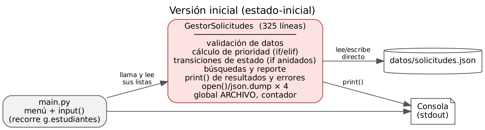
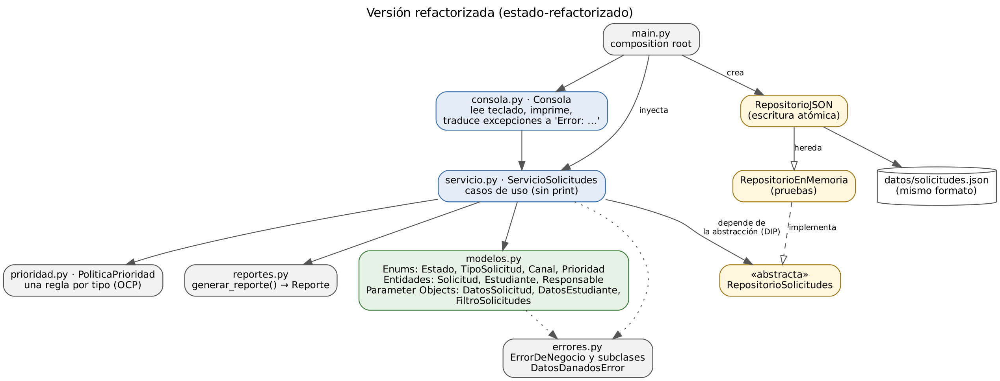

# Etapa 4 — Aplicación de SOLID y Clean Code

## Arquitectura antes y después

| Versión inicial | Versión refactorizada |
|---|---|
|  |  |

| Módulo | Responsabilidad única (razón de cambio) |
|---|---|
| `main.py` | Armar las dependencias y arrancar (composition root). |
| `consola.py` | Interacción con el usuario: leer, mostrar, traducir errores a mensajes. |
| `servicio.py` | Casos de uso: registrar, asignar, cambiar estado, buscar, reportar. |
| `modelos.py` | Tipos y reglas del dominio: estados y transiciones, validaciones, entidades. |
| `prioridad.py` | Regla de negocio de prioridad por tipo de solicitud. |
| `reportes.py` | Cálculo de las estadísticas del reporte. |
| `repositorio.py` | Persistencia (abstracción + memoria + JSON). |
| `errores.py` | Jerarquía de errores del dominio. |

## Principios SOLID

| Principio | Problema en la versión inicial | Cómo se aplicó | Dónde verlo |
|---|---|---|---|
| **SRP** – Responsabilidad única | `GestorSolicitudes` tenía al menos 5 razones de cambio: formato del archivo, reglas de validación, reglas de prioridad, transiciones de estado y formato de pantalla (CS-01). | Un módulo por responsabilidad (tabla de arriba). La entidad `Solicitud` concentra sus propias reglas de asignación y cambio de estado. | R1, R3, R5, R6 |
| **OCP** – Abierto/cerrado | Agregar un tipo de solicitud exigía editar la cadena `if/elif` de prioridad y 3 listas duplicadas (CS-08). | `PoliticaPrioridad` tiene un diccionario `tipo → regla`. Un tipo nuevo = un valor en `TipoSolicitud` + una entrada en `REGLAS_POR_DEFECTO`. Las transiciones son una tabla (`_TRANSICIONES`). | `prioridad.py`, `modelos.py`, `test_se_puede_cambiar_una_regla_sin_modificar_la_politica` |
| **LSP** – Sustitución de Liskov | No había jerarquías. | `RepositorioEnMemoria` y `RepositorioJSON` cumplen el mismo contrato `RepositorioSolicitudes`; el servicio funciona igual con cualquiera. El JSON hereda del de memoria y solo agrega carga y guardado, sin debilitar postcondiciones. | `test_implementaciones_intercambiables` |
| **ISP** – Segregación de interfaces | La UI accedía a las listas internas del gestor (`g.estudiantes`). | La consola solo conoce los métodos del servicio que necesita; `generar_reporte` recibe dos listas en lugar del repositorio completo. Con el tamaño actual no se justificó partir `RepositorioSolicitudes` en varias interfaces (ver mejoras futuras). | `consola.py`, `reportes.py` |
| **DIP** – Inversión de dependencias | La lógica abría el archivo directamente y usaba `print` y `datetime.now()` (CS-11). | `ServicioSolicitudes` recibe por constructor el repositorio (abstracción), la política de prioridad y el reloj. `main.py` decide las implementaciones concretas. | `servicio.py`, `main.py`, `test_servicio.py` |

## Clean Code

| Práctica | Antes | Después |
|---|---|---|
| **Nombres** | `p`, `pr`, `l`, `x`, `d`, `f`, `c`, `ant`, `g`, `u` | `prioridad`, `encontradas`, `responsable`, `estado anterior`, `es_nuevo`, `datos_estudiante` |
| **Funciones pequeñas** | `registrar_solicitud`: 82 líneas, CC 28 | Ninguna función supera CC 7; `registrar_solicitud` del servicio tiene CC 4 |
| **Sin duplicación** | 4 copias del guardado, 2 de la validación, 4 de prioridad→texto, 5 bucles de búsqueda | Una sola implementación de cada cosa |
| **Sin literales mágicos** | `"pendiente"`, `3`, `"ALTA"` repetidos | `Estado.PENDIENTE`, `Prioridad.ALTA`, `LONGITUD_MINIMA_DESCRIPCION` |
| **Manejo de errores** | `except:` genérico; retornos `True`/`False`/`"error"`/`None` | Excepciones del dominio (`DatosInvalidosError`, `NoEncontradoError`, `OperacionNoPermitidaError`, `DatosDanadosError`); `except` solo con tipos concretos |
| **Comando/consulta** | Los métodos calculaban *y* imprimían | El servicio devuelve datos; la consola decide cómo mostrarlos |
| **Sin código muerto** | `calcular_prioridad_vieja` comentado | Eliminado (queda en el historial de git) |
| **Efectos al importar** | `main()` se ejecutaba al importar | `if __name__ == "__main__"` |

## Comparativa de métricas

| Métrica | Inicial | Refactorizada |
|---|---|---|
| Complejidad ciclomática promedio | 11,3 (C) | **2,1 (A)** |
| Complejidad máxima por función | 28 (D) | **7 (B)** |
| Funciones con CC > 10 | 5 | **0** |
| Índice de mantenibilidad del archivo principal | 16,5 | **42,6–100** (todos los módulos A) |
| pylint | 8,66 | **10,00** |
| Avisos flake8 | 17 | **0** |
| Variables globales | 2 | **0** |
| Pruebas automatizadas | 0 | **70** (cobertura de ramas 99 %) |

> Las líneas totales aumentaron (de 427 a ~800) porque se agregaron docstrings, tipos, una abstracción de repositorio y separación en módulos. No es un objetivo reducir líneas: lo que bajó es la complejidad de cada pieza y el costo de cambiarla.

## Decisiones técnicas

| # | Decisión | Alternativa descartada | Motivo |
|---|---|---|---|
| DT-1 | Golden master (tests de caracterización por consola) como red de seguridad **antes** de refactorizar | Escribir tests unitarios del gestor original | El gestor imprimía en lugar de devolver valores; testearlo unitariamente obligaba a cambiarlo primero, que es justo lo que no se puede hacer sin red. |
| DT-2 | Mantener exactamente los mismos mensajes y el mismo formato JSON | Mejorar textos y formato en el mismo cambio | Separar "refactorizar" de "cambiar comportamiento" permite probar que no hubo regresiones. Los cambios de texto quedan como mejora futura (CR-07). |
| DT-3 | Corregir D1 y D2 dentro del TPI | Dejarlos como estaban para que el golden sea idéntico | Son defectos con riesgo de pérdida o inconsistencia de datos. Se corrigen con tests propios y se documentan como mejora de comportamiento explícita. |
| DT-4 | Enums que heredan de `str` | Enums puros | Permiten comparar con el texto ingresado por el usuario y serializar al mismo JSON sin conversiones. |
| DT-5 | Reloj inyectable en el servicio | Usar `datetime.now()` y parchear en tests | Hace explícita la dependencia del tiempo (DIP) y vuelve deterministas las pruebas. |
| DT-6 | Sin dependencias externas en producción | Usar una librería de CLI o un ORM | El foco del TPI es el diseño interno; cualquier persona puede ejecutar el sistema solo con Python. |
